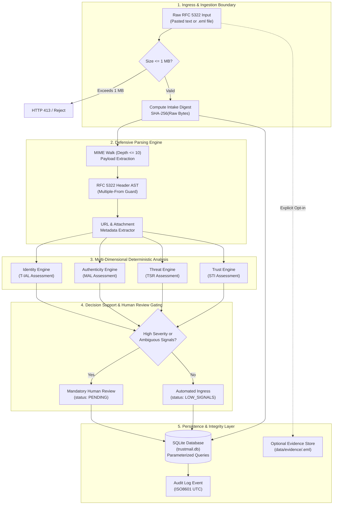

# TrustMail: Prototype System Architecture (Milestone 2)

**System Version:** 0.1.0  
**Phase:** 1 — Foundation & Working Prototype  
**Classification:** Technical Architecture & Implementation Documentation  

---

## 1. Architectural Overview

TrustMail is designed as a software-only, privacy-conscious cybersecurity platform for structured email analysis, evidence tracking, and human-in-the-loop incident triage. 

This prototype represents the **first working vertical slice** (Milestone 2) of the TrustMail architecture. It deliberately avoids premature complexity (such as live DNS resolvers, cloud provider modifications, or autonomous black-box AI models) to establish an auditable, deterministic foundation.

---

## 2. Core Subsystems

### 2.1 Ingress & Defensive Parser (`trustmail/parser.py`)
- **Strict Input Cap:** Ingress streams are metered before processing. Any payload exceeding 1 MB (1,048,576 bytes) is rejected with an HTTP 413 status, preventing memory exhaustion and denial-of-service.
- **Defensive MIME Traversal:** Employs Python's standard `email` library with `email.policy.default` (handling RFC 6532 internationalized headers and UTF-8 cleanly) with an explicit recursion depth guard (`max_parts = 100`).
- **Inert Processing:** Email payloads (HTML, scripts, binaries, attachments) are treated strictly as passive text data. Attachments are never executed or written to disk unless explicitly retained.
- **Protocol Anomaly Detection:** Validates RFC 5322 §3.6 constraints. Detects multiple `From:` headers (common in parser differential attacks) and missing mandatory headers (`Date`, `Message-ID`).

### 2.2 Orthogonal Assessment Engine (`trustmail/analyzer/`)
TrustMail strictly decouples security signals into four independent dimensions:

$$\mathbf{V}_{\text{message}} = \begin{bmatrix} \text{Identity Assurance Level (T-IAL)} \\ \text{Message Authenticity Level (MAL)} \\ \text{Threat Severity Rating (TSR)} \\ \text{Sender Trust Index (STI)} \end{bmatrix}$$

1. **Identity Assurance (`identity.py`):** Evaluates presentation headers vs envelope Return-Path. Distinguishes claimed identity from verified identity. Flags in-band `Authentication-Results` headers as **UNVERIFIED_CLAIM** because incoming headers can be spoofed prior to the first trusted MTA.
2. **Message Authenticity (`authenticity.py`):** Establishes the exact intake SHA-256 fingerprint. Inspects `DKIM-Signature` headers for dangerous legacy tags (e.g., `l=` body length limit, which permits replay body-append attacks).
3. **Threat Assessment (`threat.py`):** Executes deterministic, explainable heuristic checks:
   - *Display-Name Spoofing:* Embedded deceptive emails and high-trust brand impersonation against generic webmail domains.
   - *Suspicious URLs:* Bare IP address hosts, Punycode (`xn--`), excessive subdomain nesting, and credential harvesting paths.
   - *Urgent Financial / Credential Language:* Wire transfers, banking modifications, overdue invoices, password resets, account lockouts.
   - *Coercive Pressures:* Legal action threats, tight deadlines (within 24 hours), secrecy directives.
4. **Sender Trust (`trust.py`):** Evaluates historical baselines. Enforces the core rule: **Unknown sender $\neq$ Malicious.**

### 2.3 Epistemological Finding Partitioning
Every finding produced by the analyzer is categorized into one of four epistemological buckets:
- **`VERIFIED_FACT`:** Cryptographically or structurally proven properties (e.g., exact byte hash, byte length, extracted header strings).
- **`UNVERIFIED_CLAIM`:** Assertions made in headers that have not been validated locally (e.g., reported SPF/DKIM passes in incoming `Authentication-Results`).
- **`HEURISTIC_FINDING`:** Pattern-matching observations (e.g., financial urgency keywords, display name anomalies, URL patterns).
- **`UNKNOWN_INFORMATION`:** Explicit documentation of missing context (e.g., no communication history, no cryptographic signatures).

### 2.4 Evidence & Storage Subsystem (`trustmail/storage.py`, `trustmail/db.py`)
- **Default Privacy Mode:** Raw email bytes are discarded immediately post-assessment. Only parsed metadata, findings, assessment vector, and the intake SHA-256 digest are persisted in SQLite.
- **Explicit Retention Mode:** When a user explicitly checks the retention option, raw bytes are persisted to `data/evidence/<hash>.eml`.
- **Tamper Verification:** The system provides an on-demand verification endpoint (`/api/incidents/{id}/verify-evidence`) that recomputes the SHA-256 digest over the on-disk bytes and compares it to the original intake digest, proving local tamper detection.
- **Audit Trail:** Every intake, assessment, retention decision, review status update, and tamper check is logged to an immutable SQLite `audit_events` table with an ISO 8601 UTC timestamp.

### 2.5 Decision Support & Human-in-the-Loop Triage (`trustmail/api/routes.py`)
- **Non-Autonomous Dismissal Policy:** When High or Critical indicators are detected (financial urgency, credential phishing, header injection, spoofing), `human_review_required` is set to `True`.
- **Review Lifecycle State Machine:**
  $$\text{PENDING} \longrightarrow \text{UNDER\_REVIEW} \longrightarrow \{\text{ESCALATED}, \text{DISMISSED}, \text{CONFIRMED\_THREAT}\}$$
- Analysts record explicit investigation notes alongside state transitions, creating an accountable triage history.

---

## 3. Security & Safety Model

1. **Local Isolation:** The backend binds strictly to `127.0.0.1:8000`. No external listening sockets or public endpoints.
2. **Zero Inbound/Outbound Networking:** The analyzer makes zero outbound DNS, HTTP, or WHOIS requests during evaluation. All checks are fully deterministic and local.
3. **SQL Injection Defense:** All database queries utilize parameterized SQLite queries (`?` parameter binding).
4. **XSS & Hostile HTML Defense:** The frontend strictly escapes all user and email text (`escapeHtml()`). Raw email HTML is never injected into the DOM via `innerHTML`.
5. **No Shell Execution:** No shell commands, external processes, or system binaries are invoked from user input.
